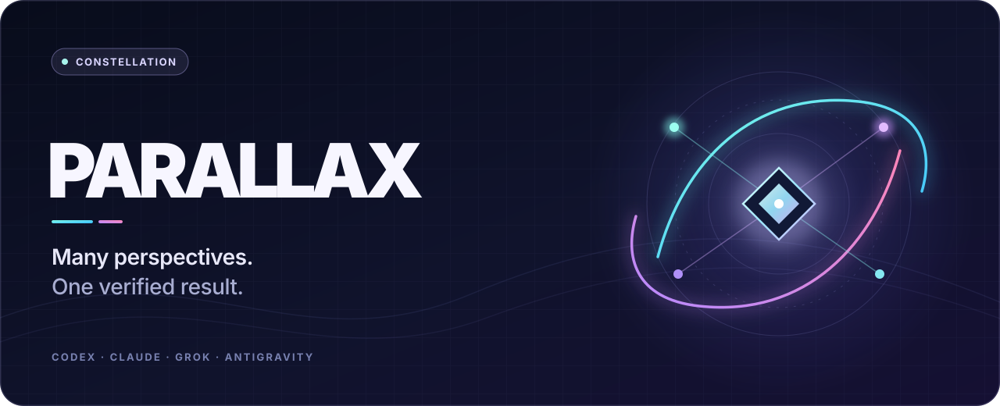
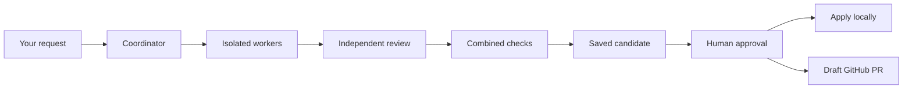

<p align="center"></p>

<p align="center"><strong>Delegate a change. Get back a reviewed patch.</strong></p>

<p align="center">
  <a href="https://github.com/ysham123/Parallax/actions/workflows/tests.yml"></a>
  <a href="LICENSE"></a>
  
</p>

Parallax runs a team of coding agents from different providers on your project and integrates only what survives independent review and your project's real checks. Codex, Claude Code, Grok Build and Antigravity can each coordinate, implement or review. Every agent works in an isolated checkout, a different provider reviews each change, and the combined result must pass your checks before a single line reaches your working tree. Each integrated result comes with a verification record.

It runs from Claude Code, from Codex, or from the command line. Studio organizes work by project and task, with team activity beside file diffs, checks, and independent reviews. Start a task, direct the team, revise a saved candidate, and approve the exact candidate when it is ready. New Studio tasks separate approval from local application or draft GitHub PR delivery. Saved recipes preserve your team, instructions, and checks; recorded progress and evidence survive disconnects and worker restarts.

This checkout documents the **1.4.0 development preview**. The public local tools are currently 1.3.0 and do not include the saved-candidate workflow, team approval or GitHub delivery shown here. For the preview, use the operator-supplied versioned source package and follow the [first-task guide](docs/FIRST-TASK.md). A reviewed local package is preparation for a pilot; live acceptance is still required.

For a bounded legacy upgrade, try [Modernize one component](examples/legacy-modernization/README.md): a runnable batch-CLI exercise with a versioned compatibility contract and 34 characterization tests. The [domain guide](docs/LEGACY-MODERNIZATION.md) explains the use case and customer comparison; [preview reliability boundaries](docs/RELIABILITY-MODERNIZATION.md) cover provisioning, recovery, evidence limits and unsupported native features.

## Install public local tools

**Claude Code**

```text
/plugin marketplace add ysham123/Parallax
/plugin install parallax@parallax
```

**Codex**

```sh
codex plugin marketplace add ysham123/Parallax
codex plugin add codex-claude-team@codex-claude-team
```

Start a new chat after installing. The Codex install ID stays `codex-claude-team` so existing installations keep updating.

**From source**

```sh
git clone https://github.com/ysham123/Parallax.git
cd Parallax
git checkout --detach a5b0ccf84cee50ff0b9c0d69df522aaf1ed4e2ee
python3 scripts/parallax.py doctor
```

Requirements: macOS, Python 3.10+, Git 2.38+, and a signed-in agent CLI (`codex`, `claude`, `grok`, `agy`) or an API key. Build and Compare also need an available provider that did not implement the candidate to review it independently. A detected sign-in does not establish remaining provider quota. Linux works where bubblewrap with user namespaces is available; CI covers it, including a live sandbox test. On first start, Parallax prepares a private Python environment from hash-locked dependencies. It changes no global packages or provider settings.

## Use the public tools

In Claude Code:

```text
/parallax:review
/parallax:build Add rate limiting to the login endpoint
/parallax:studio
```

You can also just ask: *"Have Parallax review this change with Codex and Grok."*

In Codex:

> Use Parallax to build this feature. Codex leads, Claude and Antigravity implement, and Grok reviews.

| Mode | What happens |
| --- | --- |
| **Review** | Independent read-only assessments from each reviewer, then a blind synthesis that labels them A, B, C. |
| **Build** | The coordinator plans scoped tasks with file ownership. Workers implement in isolation, each change gets an independent review, and the combined result must pass your checks before integration. |
| **Compare** | Alternative complete implementations, each checked against the same commands. The selected candidate is verified again before integration. |

The default team uses Codex as coordinator, Claude Code and Antigravity as implementers and Grok Build as reviewer. It runs at high effort, with three concurrent workers, two repair rounds per task and a 45-minute limit. Change any of it in Studio or in the run specification. Explicit model and effort choices are never silently substituted.

## How a run reaches your project



This is the new Studio workflow. Existing CLI/plugin runs and legacy Studio records retain their recorded integration behavior. Team and GitHub delivery features require the invited-pilot configuration described below.

- **Your work is preserved.** Parallax snapshots staged, unstaged and untracked changes without touching your index, works in private worktrees, and applies only the verified patch. Conflicts, failed checks or unsupported setups stop as **Needs attention**, with all work kept.
- **Checks are the gate.** Integration requires meaningful check commands, given as argv arrays such as `["npm", "test"]`. An agent saying tests passed is not verification.
- **No shared transcript.** Every model call receives a compact, role-scoped packet compiled from saved state, never a growing conversation. Coordinator turns, repairs and reviews start fresh sessions. Workers see only their own task, and reviewers never learn who wrote the change they judge.
- **Exploration in isolation.** When approaches genuinely differ, the coordinator can run two or more variants of a task in separate checkouts. Each is reviewed and checked independently, and only the selected one merges.
- **Project memory.** A local idea graph records what earlier runs in the project tried and what the evidence showed. After each run, one isolated session distills at most three lessons, each grounded in recorded evidence. Only coordinators read memory, as dated observations rather than rules. Turn it off with `PARALLAX_MEMORY=off`.
- **Evidence you can keep.** The verification record lists the gates, settings, checks and patch hash, without prompts or raw sessions. It is evidence, not a correctness guarantee.

See [architecture](docs/ARCHITECTURE.md) for the full design and [real-project delivery](docs/DELIVERY.md) for setup behavior.

## Studio

Studio opens on **Tasks**. Search the queue, filter by project or status, and open a task to follow activity beside its per-file diff, command results, independent reviews, and saved settings. Send guidance during execution. Afterward, **Revise candidate** starts from the saved patch and original project baseline; **New task from current project** captures the developer's current files. Both create separate candidates with fresh evidence and approval. **New task** includes project readiness, a workflow selector, and configurable team, instructions, and checks that you can save as versioned recipes.

New tasks use **Approve candidate**, followed by an explicit **Apply locally** or **Publish draft PR** action. Team candidates need approval from another human with access to that project; Owners cannot approve their own request. Legacy records retain **Approve & apply**. Source drift, failed checks and failed review stop delivery. Waiting candidates survive worker restarts. See the [workflow guide](docs/WORKFLOWS.md) and [invited-pilot setup](docs/PILOT.md).

**Agent graph** shows the active or selected run, including who coordinates, implements and reviews. The task graph shows dependencies, repairs, reviews and checks. When the coordinator explores alternatives, the task graph shows each variant by round and marks the one it kept. Inspectors show what each agent's context packet contained, by section and size. **Advanced run** keeps the direct review/build/compare controls and project memory settings. You can steer a run at its next checkpoint, pause it, stop it or resume it. **Run evidence** brings together baseline and final checks, the combined diff, findings and the verification record.

Local Studio binds to loopback only. Its launch link exchanges a local access token for an HttpOnly session cookie and removes the token from the address bar, and Studio rejects cross-origin requests. Hosted Studio uses the authenticated relay described below.

## Providers

| Provider | CLI | API |
| --- | --- | --- |
| Codex | `codex` | OpenAI Responses |
| Claude Code | `claude` | Anthropic Messages |
| Grok Build | `grok` | xAI Responses |
| Antigravity | `agy` | Gemini through Google's OpenAI-compatible endpoint |

CLI connections use your existing sign-ins. API keys are stored in macOS Keychain or referenced by environment variable. They never appear in run specifications, profiles, the database or browser storage. Custom models can connect through any OpenAI-compatible HTTPS endpoint with an explicit model and capability catalog. Prompts and relevant project content go to the endpoints you select. Execution and private working copies stay on your machine; local-only history stays there too. Connected hosted workspaces mirror evidence to their relay, including task prompts and settings, changes, check output, agent output and session metadata.

## Hosted Studio and paired machines

Parallax can also run as a hosted Studio on Vercel with a runtime on Railway. Depending on the deployment's enrollment settings, users sign in with email, GitHub or Google and get a private personal workspace. Explicit team workspaces add invited members, project permissions and shared versioned recipes. Their agents run on machines paired into that workspace with an outbound worker, scoped to exact locally approved project folders. Execution, provider sign-ins and API keys stay on those machines. Mirrored evidence can contain source code and is retained within the relay's storage limits. A sleeping or offline worker cannot accept new work; team task inspection currently also requires an online worker to enforce project filtering. See [deployment](docs/DEPLOYMENT.md), [paired machines](docs/LOCAL-WORKERS.md) and [pilot privacy and recovery](docs/PILOT.md#data-support-and-recovery). The hosted Studio publishes its privacy policy, terms and support page at `/privacy`, `/terms` and `/support`.

## Command line

```sh
python3 scripts/parallax.py doctor                      # provider readiness
python3 scripts/parallax.py studio --workspace PATH     # open Studio
python3 scripts/parallax.py assess --workspace PATH     # project readiness and checks
python3 scripts/parallax.py run --spec run.json --wait  # start a run
python3 scripts/parallax.py status RUN_ID
python3 scripts/parallax.py steer RUN_ID --message "Keep the public API stable"
python3 scripts/parallax.py receipt RUN_ID              # verification record
python3 scripts/parallax.py worker --url URL --workspace PATH   # pair with a hosted Studio
```

The CLI, Studio and the bundled stdio MCP server share one local runtime, and inputs and results follow the versioned [contracts](src/parallax/models.py). `PARALLAX_HOME` selects another state directory. The original `scripts/claude_bridge.py` interface remains supported.

The optional [remote MCP integration](docs/REMOTE-MCP.md) lets account-authorized clients use paired machines through hosted Studio. It is disabled by default and requires Supabase OAuth setup. `python3 scripts/build_openai_plugin.py --draft` prepares the separate OpenAI directory package; the existing local plugins keep their install IDs.

## Limits

- Build and Compare need a Git repository. Review works in any folder.
- Git submodules and symlinks that point outside the project need manual handling.
- Automatic Python setup requires wheel-only requirements with exact versions and hashes. Source builds, editable/VCS installs and unlocked dependency declarations are refused. Locked npm projects run with lifecycle scripts disabled; Yarn, pnpm and npm workspaces need a prepared environment. See [the preview dependency policy](docs/RELIABILITY-MODERNIZATION.md).
- API command execution requires enforced command isolation: the macOS sandbox or Linux bubblewrap with the required namespaces. Native provider readiness is checked separately. SSH workers and remote filesystem mounts are not supported.
- CLI/plugin integration remains local. Versioned Studio tasks separate human approval from local application or draft GitHub PR delivery. GitHub delivery requires a configured App and a clean captured remote baseline; merging and deployment stay with you.
- Team workspaces and GitHub delivery are gated by `PARALLAX_PILOT_ENABLED=on` for staging and invited pilots. See [pilot setup and launch checklist](docs/PILOT.md).

## Develop

```sh
uv sync --extra test
uv run python -m ensurepip --upgrade
PYTHONPATH=src uv run python -m unittest discover -s tests
npm ci --prefix studio && npm run build --prefix studio
python3 scripts/validate_release.py
```

Python check provisioning needs pip in the runtime interpreter. The portable launcher supplies it; existing uv or pipx environments may need the standard-library `ensurepip` step above. If that interpreter omits ensurepip, use a standard Python virtual environment with pip.

Tests use deterministic fake agents, so no provider is called. CI runs Python 3.10 and 3.13 on macOS and Linux, plus Studio and container checks. Recorded native and team runs are in [docs/validation](docs/validation). See [CONTRIBUTING.md](CONTRIBUTING.md), [SECURITY.md](SECURITY.md), [CHANGELOG.md](CHANGELOG.md) and [UPGRADE.md](UPGRADE.md).

## License

MIT. Provider marks identify their services and remain their owners' trademarks; see [asset provenance](studio/ASSETS.md).
